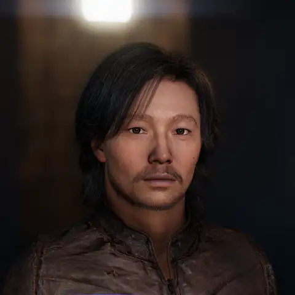

# MetaHuman URP

Experimental MetaHuman rendering and interchange for Unity 6000.6 and URP 17.6. Independent integration; not an official Unity or Epic product.

[](Media/Taro-talking.mp4)

*The sample scene in Play mode: one line, 11.7 s, with the real-time hair path. Click for the video with sound.*

| Folder | Contents |
| --- | --- |
| [`MetahumanURP`](MetahumanURP/README.md) | The `metahuman-urp` UPM package: importer, skin/eye/hair rendering, DNA face driver, Unreal export tools. |
| [`SampleProject`](SampleProject) | Unity project with one scene: the character Taro in a look-development stage, talking. |

## Getting started

1. Install [Git LFS](https://git-lfs.com) (`git lfs install`), then clone `https://github.com/lofihashbloom/MetahumanURP.git`. The sample's character data is stored through Git LFS; without it the scene opens with missing meshes and textures.
2. Open `SampleProject` in Unity 6000.6 (Unity Hub > Add project from disk). Its manifest references the package with `file:../../MetahumanURP`. The first import takes several minutes.
3. Open `Assets/Taro/TaroPhoto.unity` and enter Play mode.

Tested on Apple silicon with Metal only. The face rig uses a native plugin that ships for macOS arm64, and the deferred hair renderer is Metal only.

## Using the package in another project

In a Unity 6000.6 / URP 17.6 project, choose **Package Manager > Install package from git URL** and enter:

```
https://github.com/lofihashbloom/MetahumanURP.git?path=/MetahumanURP
```

Append `#<tag or commit>` to pin a revision. The package is not on a registry.

## The sample scene

Taro says one line on a loop while the camera orbits and pushes in. In Play mode, **Space** restarts the line and **C** stops or resumes the camera.

`PhotoShotPlayer` (on `Taro`) drives the shot:

- **Face.** A `TalkTrack` of DNA rig controls at 30 fps, played through `DnaRigDriver` and timed to the audio. The mouth was generated from the recording and corrected by hand; blinks, gaze and nods are authored. Not a captured performance.
- **Hair.** Scalp hair is rigid with a light sway and uses the deferred groom renderer. Brows, lashes, moustache and goatee follow the skin through `GroomSurfaceBinding`, bound when Play mode starts.
- **Body.** A bust: head, neck and the jacket to the waist. The jacket is skinned to the body, without cloth simulation.
- **Look.** Fixed spot lights and backdrop, the package's skin, eye and hair shading, and a film grade (`FilmGradeFeature`).

Limits: hair shadows on the skin are baked for the rest pose, skin scattering is screen-space, and the leather uses the skin shader. None of this is Unreal or DNA parity.

## On-device conversation (Unity Sentis)

`Assets/Taro/TaroSentis.unity` turns Taro into a chat partner that runs entirely on the device through Unity Inference Engine (Sentis): type a line, Taro answers in one sentence, speaks it and lip-syncs it on the DNA rig.

- **Reply:** [Gemma 3 270M IT](https://huggingface.co/Sky-Kim/com.sky.sentis.gemma3-270m-it), with the last three exchanges as context.
- **Voice:** [Supertonic](https://huggingface.co/Sky-Kim/com.sky.sentis.supertonic) TTS (voice M5; Korean and Japanese are detected from the text).
- **Face:** [NeuroSync](https://huggingface.co/Sky-Kim/com.sky.sentis.neurosync) audio-to-face curves, mapped from ARKit channels to `CTRL_expressions` (`ArkitToDna`) and played on the audio clock with a short ease in and out.

The idle performance (blinks, gaze, head and hair) and the camera orbit of the sample shot are kept. While the input field is not focused, **Space** replays the last reply and **C** pauses or resumes the camera; **Esc** stops a reply. The scene is a copy of `TaroPhoto.unity` with `LocalAvatar` on Taro, the chat UI (reply text at the top, the input field at the bottom) and its own copy of the pipeline with sharper spot-light shadows (`Assets/Taro/Rendering/Sentis`).

The three models come as UPM packages from Hugging Face (Git LFS, about 3 GB on first import); their licences are listed in [`THIRD_PARTY_LICENSES.md`](THIRD_PARTY_LICENSES.md). Input handling is set to **Both** because the chat field is a uGUI `InputField`. In the Editor the models load from the packages; a player build needs the `Models~` folders of the Gemma and Supertonic packages copied to `StreamingAssets/<package name>` (NeuroSync writes its own at build time).

## Licences

The original code, shaders and tooling are MIT licensed ([`LICENSE`](LICENSE)). The sample also contains third-party content, which keeps its own licence: the MetaHuman character Taro (Epic Games), the leather jacket derived from Unity's Time Ghost character, and a speech recording generated with ElevenLabs. Their sources, licences and what was changed are listed in [`THIRD_PARTY_LICENSES.md`](THIRD_PARTY_LICENSES.md). That content is stored through Git LFS in `SampleProject/Assets/Taro`.

To use your own characters, export them from Unreal with the package's `Tools~/Unreal` scripts and import them with **Tools > MetaHuman > Import Selected Manifest** (see the [package README](MetahumanURP/README.md)).
